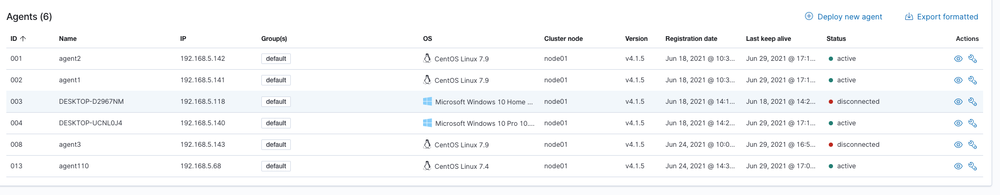
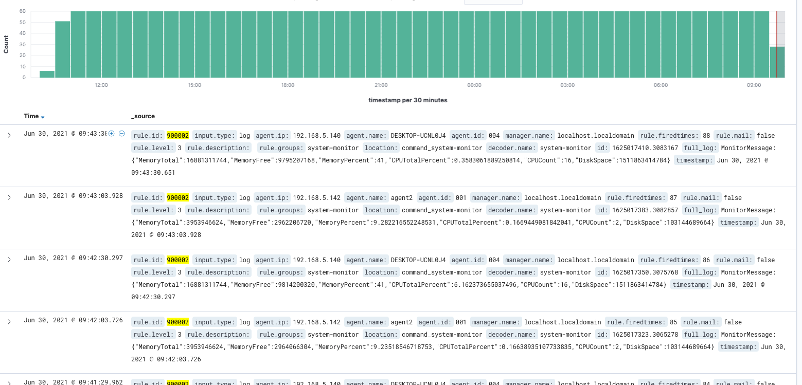

# wazuh 安装注意事项

## wazuh-agent 安装

### linux 安装

1. https://documentation.wazuh.com/current/installation-guide/packages-list.html#linux 下载对应系统对应cpu架构的安装包

2. 配置/var/ossec/etc/ossec.conf,修改MANAGER_IP为wazuh-manager的ip地址
   ```xml
   <client>
   	<server>
   		<address>MANAGER_IP</address>
   		...
   		</server>
   </client>
   ```
   
3. 执行 systemctl start wazuh-agent

4. 查看https://192.168.5.125/app/wazuh#/agents-preview/?_g=(filters:!(),refreshInterval:(pause:!t,value:0),time:(from:now-24h,to:now))&_a=(columns:!(_source),filters:!(('$state':(isImplicit:!t,store:appState),meta:(alias:!n,disabled:!f,index:'wazuh-alerts-*',key:manager.name,negate:!f,params:(query:localhost.localdomain),removable:!f,type:phrase),query:(match:(manager.name:(query:localhost.localdomain,type:phrase))))),index:'wazuh-alerts-*',interval:auto,query:(language:kuery,query:''),sort:!()) 查看状态，如下图表示成功
    

5. 远程命令 安装，比如脚本监控

### linux agent remote command使用

#### agent端

###### 启用agent 远程执行命令

```
echo "wazuh_command.remote_commands=1" >> /var/ossec/etc/local_internal_options.conf
systemctl restart wazuh-agent
```

###### agent端 etc/shared/agent.conf 新增的命令monitor,获取系统指标信息，例如/root/test/monitor,表示agent 1min执行脚本一次，获取系统指标性信息

```xml
<agent_config>

  <!-- Shared agent configuration here -->
  <wodle name="command">
    <disabled>no</disabled>
    <tag>system-monitor</tag>
    <command>/root/test/monitor</command>
    <interval>1m</interval>
    <run_on_start>yes</run_on_start>
    <timeout>10</timeout>
    <skip_verification>yes</skip_verification>
  </wodle>
</agent_config>
```

#### agent-manager

###### 新增decoder，用于解析命令的内容

```xml
<decoder name="system-monitor">
    <prematch>^MonitorMessage:</prematch>
    <regex offset="after_prematch">+(\w)</regex>
    <order>monitorString</order>
</decoder>
```

###### 新增rule,触发规则，就会产生对应的alert事件

```xml
<group name="system-monitor">

  <rule id="900001" level="0">
    <decoded_as>system-monitor</decoded_as>
    <description>Disk-usage monitoring rules.</description>
  </rule>

  <rule id="900002" level="3">
    <if_sid>900001</if_sid>
    <match>MonitorMessage</match>
    <description>$(monitorString)</description>
  </rule>
</group>
```

###### 产生的数据展示



### windows agent安装

1. 下载[wazuh-agent-4.1.5-1.msi](https://packages.wazuh.com/4.x/windows/wazuh-agent-4.1.5-1.msi) 
2. powershell 管理员权限执行   ` .\wazuh-agent-4.1.5-1.msi /q WAZUH_MANAGER="192.168.5.125" WAZUH_REGISTRATION_SERVER="192.168.5.125"` 完成agent跟 wazuh-manager注册

### windows agent remote command

windows agent测跟linux一样，只是windows可执行命令是 monitor.exe,配置文件路径如下

1. C:\Program Files (x86)\ossec-agent\shared\agent.conf
2. C:\Program Files (x86)\ossec-agent\local_internal_options.conf

